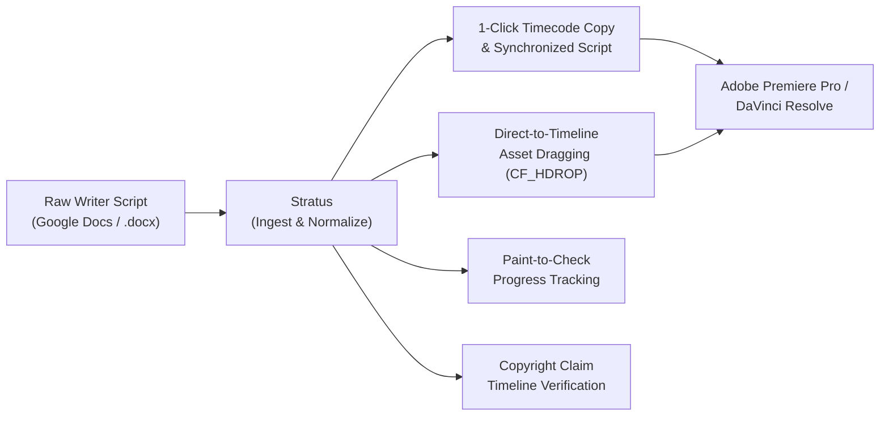
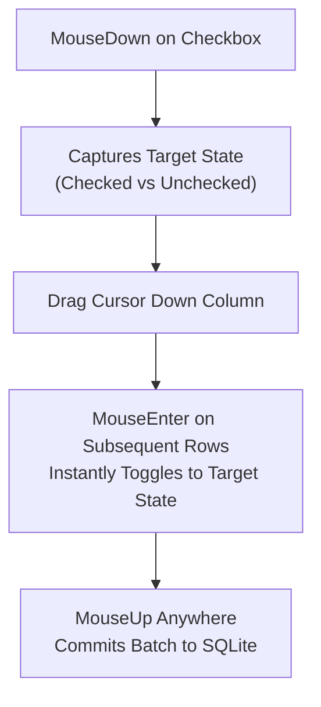
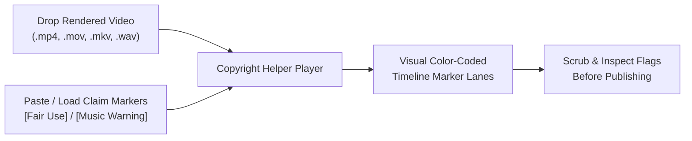

# Stratus — Video Editor Operations Playbook & Workflow Guide

> An open-source desktop workstation built for video editors to eliminate script friction, standardize timecodes, and accelerate A-Roll assembly in Adobe Premiere Pro and DaVinci Resolve.

---

## Executive Summary

A significant portion of post-production time is often lost to script friction:
- Switching back and forth between a dark NLE timeline and a bright browser document.
- Manually converting unpadded `MM:SS` writer timestamps into standard NLE timecodes (`HH:MM:SS:FF`).
- Extracting embedded images from `.docx` files and importing them through multiple file dialogs.
- Tracking which B-Roll links, voiceover lines, or clips have already been placed on the timeline.

**Stratus** replaces this fragmented workflow with a desktop environment bridging raw `.docx` scripts and your NLE timeline.



---

## Workflow Comparison

| Problem Area | Traditional Google Docs Workflow | Stratus Workflow |
| :--- | :--- | :--- |
| **Eye Fatigue** | Bright white pages next to a dark editing timeline. | **Multi-Variant Dark Mode** (Deep Blue, Pitch Black, Slate Gray, Pink) matching your NLE workspace. |
| **Timecode Format** | Unpadded `MM:SS` (e.g. `1:23` or `12:45`) requiring manual padding. | **Automatic SMPTE Conversion**: Parses every timestamp to padded `HH:MM:SS:FF` with duration totals. |
| **Playhead Navigation** | Highlight, copy, switch windows, select timecode box, paste. | **1-Click Copy & Sync**: Click any timestamp to copy standard timecode and scroll the script to that exact line. |
| **Checklist Fatigue** | No built-in checklists; manual highlighting or guesswork. | **Paint-to-Check**: Click and drag down the checkbox column to toggle dozens of rows in a single pass. |
| **Image Extraction** | Save images from Word/Docs, locate folder, import into bin. | **Direct Asset Drag**: Drag extracted document images straight onto your NLE timeline or project bin. |
| **Scattered Links** | Messy URLs with tracking parameters and broken query strings. | **Automated Link Normalization**: Standardizes YouTube URLs and strips Google Drive clutter. |
| **Data Safety** | Accidental tab closes or lost position in long scripts. | **Local SQLite DataVault**: Persistent `stratus.db` auto-saving every click with a 30-day Recycle Bin. |

---

## 1. Ingestion & Timecode Normalization

### Drag-and-Drop Ingestion
Export a finished script from Google Docs as `.docx` and drop it anywhere inside the Stratus window.

- **Document Signature (`stratus_prog_<path>`)**: Identifies the file and restores any previously saved checkboxes, custom notes, or link states.
- **Background Sidecar Engine**: Extracts paragraphs, hyperlinks, notes, and embedded images without blocking the UI.

### Automatic SMPTE Timecode Padding
Raw writer timestamps (`0:45`, `3:12`, `14:02`) are standardized into broadcast-ready SMPTE timecodes:

$$\text{Raw Input: } 2:15 \longrightarrow \text{Stratus SMPTE: } \mathbf{00:02:15:00} \quad (\text{Duration: } 135\text{s})$$

- **1-Click Copy**: Clicking a timecode pill copies the formatted string to your clipboard.
- **Jump to Playhead**: Paste (`Ctrl+V`) into Premiere Pro or DaVinci Resolve's timecode box and press Enter to land on the exact frame.

---

## 2. Synchronized Dual-Pane Workspace

```
+-------------------------------------------------------------------------+
| [TitleBar] Stratus                               [Stats] [Vault] [Theme]|
+------------------------------------+------------------------------------+
| DOCUMENT PANE (Left)               | RESULTS PANE (Right)               |
| - Full formatted script text       | - Formatted A-Roll timestamp cards |
| - Highlighted dialogue & cues      | - 1-Click Copy pills (HH:MM:SS:FF) |
| - Extracted embedded docx images   | - Paint-to-Check checkboxes        |
| - Synchronized scroll destination  | - Cleaned external source links    |
+------------------------------------+------------------------------------+
```

### Synchronized Script Tracking
Click any A-Roll card in the Results Pane and the Document Pane automatically scrolls to and highlights the exact sentence (`active-sync`).

### Custom Editor Notes
Right-click any script block to attach custom editor notes or audio reminders. Notes are persisted in SQLite across sessions.

---

## 3. Paint-to-Check Progress Tracking



1. Hover over the checkbox column in the Results Pane.
2. Click and hold the primary mouse button.
3. Drag downwards across multiple rows to batch-check or batch-uncheck.
4. Release to auto-save all changes.

---

## 4. Copyright Helper (Discontinued)

> **Status: Discontinued.** This experimental feature is left in the codebase for reference only and is not actively maintained. Due to conflicts between React and the Tauri file-reading bridge, importing a video dumps the entire file into RAM rather than streaming directly from disk. Avoid importing large video files.

The **Copyright Helper** provides a built-in media player with visual marker lanes to audit video/audio exports against claim timestamps before publishing.



- **Media Support**: `.mp4`, `.mov`, `.avi`, `.mkv`, `.webm`, `.wav`, and `.mp3`.
- **Marker Presets**: Supports `[YouTube Fair Use]`, `[Clip Commentary]`, and `[Music Track Warning]` segments.
- **Lane Toggles**: Isolate audio vs. visual claim segments with one click.

---

## 5. DataVault & Persistence

Stratus stores all checklist states, custom notes, settings, and stats in a local SQLite database (`stratus.db`).

- **Zero-Loss Auto-Save**: Every state change writes immediately to SQLite.
- **30-Day Recycle Bin**: Soft-deleted document states remain recoverable in the DataVault for 30 days.
- **Productivity Metrics**: View total A-Rolls processed, logged duration, and lifetime app uptime in the Stats modal.

---

## 6. Shortcuts & Controls

| Shortcut / Action | Function |
| :--- | :--- |
| `Shift + F` (Customizable) | Toggle Widescreen Mode. |
| Click Timecode Pill | Copy normalized `HH:MM:SS:FF` to clipboard. |
| Click Script Sentence | Highlight and sync the corresponding block. |
| Drag Checkbox Column | Paint-to-Check multi-row toggling. |
| TitleBar Drag | Native window movement and edge snapping. |

---

## Practical Tips

1. **Dual-Monitor Setup**: Keep Stratus on your secondary monitor in Dark Mode alongside your NLE timeline.
2. **Speed Navigation**: Click a timestamp in Stratus, switch to Premiere, press `Ctrl+V` then Enter to jump straight to that frame.
3. **Clean Research Links**: Use the Links modal to track and open normalized YouTube and Google Drive references without junk parameters.
